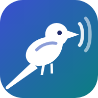
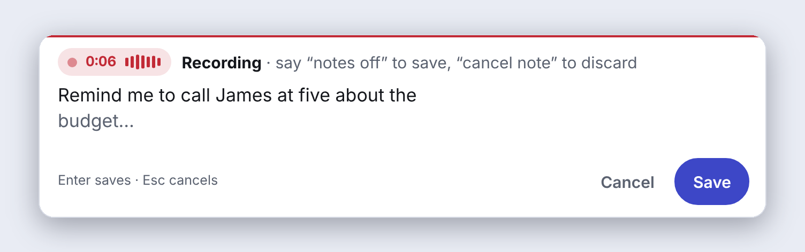
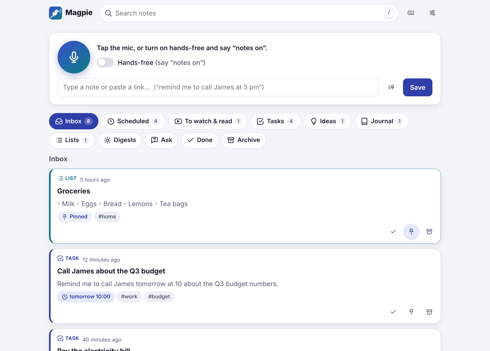

<p align="center">
  
</p>

<h1 align="center">Magpie</h1>

<p align="center">
  <strong>Say “notes on”, talk, and Magpie does the rest.</strong><br>
  A voice notes app for Windows and Mac. It listens for “notes on” in any program, writes<br>
  down what you say, and the AI you choose files the note and reminds you when it matters.
</p>

<p align="center">
  <a href="https://github.com/Coder-ux-coder/magpie/releases/latest/download/MagpieSetup.exe"><strong>Download for Windows</strong></a>
  ·
  <a href="#mac"><strong>Install on a Mac</strong></a>
</p>

<p align="center">
  <a href="https://github.com/Coder-ux-coder/magpie/actions/workflows/app.yml"></a>
  <a href="https://github.com/Coder-ux-coder/magpie/actions/workflows/ci.yml"></a>
  <a href="LICENSE"></a>
</p>

<p align="center">
  
</p>

## Install

### Windows

**Download [MagpieSetup.exe](https://github.com/Coder-ux-coder/magpie/releases/latest/download/MagpieSetup.exe)**
and double-click it. There's nothing to answer and no administrator password. (If Windows
says *Windows protected your PC*, click **More info**, then **Run anyway**: Magpie isn't
signed by a company.) Or paste this into PowerShell:

```powershell
irm https://raw.githubusercontent.com/Coder-ux-coder/magpie/main/install.ps1 | iex
```

### Mac

For Macs with Apple silicon (M1 or newer) and macOS 14 (Sonoma) or newer. Open
**Terminal** and paste:

```sh
curl -fsSL https://raw.githubusercontent.com/Coder-ux-coder/magpie/main/install.sh | sh
```

It puts Magpie in Applications and opens it. Allow the microphone when your Mac asks.

### Then

1. **Choose your AI** on the welcome screen: Claude, Codex (your ChatGPT sign-in, no key),
   ChatGPT, Gemini, OpenRouter, a free AI on your own computer (Ollama), or none.
2. **Say “notes on”**, your note, then **“notes off”**. That's it.

Magpie starts with your computer and waits by the clock (Windows) or in the menu bar
(Mac). It keeps itself up to date, and **Settings → Updates** has an update button. On its
first start it downloads Whisper's speech models in the background (480 MB, plus 1.6 GB
for the most accurate one on a quick computer). There's no account and no password, and
your notes stay on your computer.

## No API key?

- **ChatGPT users: choose Codex.** Install [Codex](https://github.com/openai/codex), OpenAI's
  command-line tool, sign it in with `codex login`, and choose **Codex** in Magpie's welcome
  screen or Settings → AI. Magpie runs it on your computer for each note; there's no key to
  paste and Magpie never sees your sign-in. Your Codex plan's limits apply.
- **Claude users: use Magpie inside Claude** (below).

### Use Claude without an API key

Apps outside Claude, this one included, can't use a Claude subscription. So
[`artifact/magpie.html`](artifact/magpie.html) is a version of Magpie that runs **inside
Claude** as an artifact: Claude files your notes with your own Claude account, so there's no
API key and nothing to install. It has your categories, reminders while it's open (plus
Google Calendar and Outlook links), *My day* and *Ask*. To make your own copy, ask Claude
Code to *“publish `artifact/magpie.html` as an artifact with the db, user, sample, downloads
and permissions capabilities”*. Its notes export to a file the app imports (Settings → Data).

## Set Magpie up for someone (for AI agents)

Magpie runs on the person's own computer, so run these there. No administrator rights are
needed, and nothing asks questions.

1. **Install or update Magpie, and start it.** On Windows, in PowerShell:

   ```powershell
   powershell -NoProfile -ExecutionPolicy Bypass -Command "irm https://raw.githubusercontent.com/Coder-ux-coder/magpie/main/install.ps1 | iex"
   ```

   On a Mac with Apple silicon, in Terminal:

   ```sh
   curl -fsSL https://raw.githubusercontent.com/Coder-ux-coder/magpie/main/install.sh | sh
   ```

   Each downloads the latest release, checks it against the release's SHA-256, installs it
   for the current user, and waits until Magpie answers. The last line is Magpie's address,
   such as `http://127.0.0.1:8000` (also in `running.json` in Magpie's folder, below). The
   welcome screen then opens for the person; on a Mac, they allow the microphone.

2. **Optionally choose the AI for them** (otherwise the welcome screen asks). The key is
   checked before it's saved, and never shown again:

   ```powershell
   $magpie = "http://127.0.0.1:8000"   # the address the installer printed
   Invoke-RestMethod "$magpie/api/ai" -Method Put -Headers @{ "X-Magpie" = "1" } `
     -ContentType "application/json" -Body '{"provider": "claude", "key": "sk-ant-..."}'
   ```

   ```sh
   curl -fsS -X PUT http://127.0.0.1:8000/api/ai -H "X-Magpie: 1" \
     -H "Content-Type: application/json" -d '{"provider": "claude", "key": "sk-ant-..."}'
   ```

   Providers: `claude`, `openai`, `gemini`, `openrouter`, `ollama` (free, local; no key),
   `codex` (no key), `compatible` (add `"base_url"`), or `basic` (no AI). Add `"model"` to
   pick a model. For `codex`, install Codex first
   ([github.com/openai/codex](https://github.com/openai/codex)) and have the person run
   `codex login` in a new window, which signs in through their browser; then send
   `{"provider": "codex"}`.

   To have voice notes written down by a speech service of their own instead of Whisper,
   save the service (checked like the AI's key), then choose it:

   ```sh
   curl -fsS -X PUT http://127.0.0.1:8000/api/speech -H "X-Magpie: 1" \
     -H "Content-Type: application/json" -d '{"service": "groq", "key": "gsk_..."}'
   curl -fsS -X PUT http://127.0.0.1:8000/api/prefs -H "X-Magpie: 1" \
     -H "Content-Type: application/json" -d '{"speech_model": "service"}'
   ```

   Services: `openai`, `groq`, `deepgram`, `elevenlabs`, `assemblyai`, `gladia`, or
   `compatible` with `"base_url"`. For their own dictation app (Glaido, Wispr Flow…), send
   `{"speech_model": "dictation"}` to `/api/prefs` instead; `"vocabulary"` there lists names
   and words to listen out for.

3. **Check that it listens:** `GET /api/desktop` answers
   `{"active": true, "state": "standby", ...}`. `"no-mic"` or `"muted"` means the computer
   gives Magpie no microphone: on Windows, Settings → Privacy & security → Microphone →
   *Let desktop apps access your microphone*; on a Mac, System Settings → Privacy &
   Security → Microphone → Magpie. Its `speech` part shows Whisper's download, then
   `"ready"`; its `update` part shows updates.

Good to know:

- Requests from the same computer need no password or token; `POST`, `PUT` and `DELETE`
  need the header `X-Magpie: 1`. The full API is described at `/api/docs`.
- Add a note: `POST /api/notes` with `{"text": "Remind me to call James at 5pm"}`.
- Magpie's folder (notes, settings, `logs`): `%LOCALAPPDATA%\Magpie` on Windows,
  `~/Library/Application Support/Magpie` on a Mac.
- To remove it on Windows: Settings → Apps → Magpie, or
  `& "$env:LOCALAPPDATA\Programs\Magpie\unins000.exe" /VERYSILENT`. On a Mac: untick *Start
  Magpie with your Mac* in its menu, quit it, and drag Magpie from Applications to the Bin.
  Notes are kept in its folder.
- If the person used Magpie in Docker before, the app brings those notes and settings over
  on its first start and stops the Docker copy.

## Using it

- **Say “notes on”** at the start of a sentence, in any program. A small bar appears at the
  bottom of the screen with your words as you speak, without taking the keyboard from what
  you're doing. **“Notes off”** saves the note (so does a pause, or **Save**); **“cancel
  note”** throws it away, with **Undo**. Click the bar to type into it.
- **Accurate words:** as you speak, Whisper writes your words in the bar, and when the note
  ends it writes the whole note down again, with punctuation, using its most accurate
  model if your computer is quick enough for it. It copes with accents, and you can give
  it names and words to listen out for. It runs on your computer: no audio leaves it.
- **Or bring your own:** in Settings → Voice (or on the welcome screen), choose a **speech
  service** of your own with its key (OpenAI, Groq, Deepgram, ElevenLabs, AssemblyAI,
  Gladia, or any OpenAI-compatible server), or your own **dictation app** (Glaido, Wispr
  Flow, Superwhisper, Windows voice typing, Dictation on a Mac): “notes on” then opens the
  bar for it to type into, and the note is saved when its words end with “notes off”.
- **The AI files it:** it tidies your words, gives the note a title, a kind (task, idea,
  link, …) and one of your own categories, and decides whether and when to remind you:
  “remind me at 5”, “every Monday at 9”, or, for “the bill is due on the 10th”, the evening
  before.
- **Reminders pop up** in the corner of the screen with Done and Snooze. On your phone, get
  them by **email** or **Telegram** (Settings → Reminders); Telegram can take notes too.
- **Magpie's icon** (by the clock, or in the Mac's menu bar) opens your notes, starts a
  note, turns listening off and on, and checks for updates.
- **Your notes:** categories with colours, search, a daily digest, **Ask** (“what did I
  decide about rent?”), and short reviews of the videos and articles you save. Magpie learns
  from your corrections.

<p align="center">
  
</p>

More in the **[guide](docs/guide.md)**: everyday use, how Magpie hears you, choosing the AI,
reminders on your phone, and fixes for common problems.

## From Python

On an Intel Mac or Linux, run Magpie from Python 3.11 or newer (Linux needs GTK or Qt for
its windows). It works the same way, but doesn't update itself: run the first line again
for a new version.

```bash
python3 -m pip install "magpie-notes[desktop] @ https://github.com/Coder-ux-coder/magpie/archive/refs/heads/main.zip"
python3 -m magpie desktop
```

## Privacy

Your notes are a SQLite file on your computer. Magpie sends **note text** (and pages you
save) to the AI you chose, for filing, reviews and Ask (nothing with Ollama or no AI);
**reminders** to the channels you set up (email, Telegram, …); asks GitHub for new versions
every few hours; and downloads its speech models from Hugging Face once. **No audio leaves
your computer**, unless you choose a speech service of your own: then each voice note's
sound goes to that service. See [SECURITY.md](SECURITY.md) to report a vulnerability.

## Development

```bash
git clone https://github.com/Coder-ux-coder/magpie.git && cd magpie
python -m venv .venv && . .venv/bin/activate
pip install -e ".[dev,mcp,desktop]"
MAGPIE_BRAIN=fake magpie desktop          # the app, with an offline stand-in for the AI
pytest -q && ruff check src tests scripts && pyright
```

The app is one Python process: the Magpie server (FastAPI and SQLite), its web pages,
offline listening (Vosk) and writing down (Whisper), and a tray or menu bar icon.
[AGENTS.md](AGENTS.md) explains the code for people and AI agents,
[docs/architecture.md](docs/architecture.md) how it fits together, and
[docs/SPEC.md](docs/SPEC.md) what it's for. The *App* workflow builds `MagpieSetup.exe` and
`Magpie-mac.zip`, tests each on a real Windows and Mac, and publishes a release for each new
version.

## License

[MIT](LICENSE). Magpie is an independent open-source project and is not affiliated with Anthropic.
