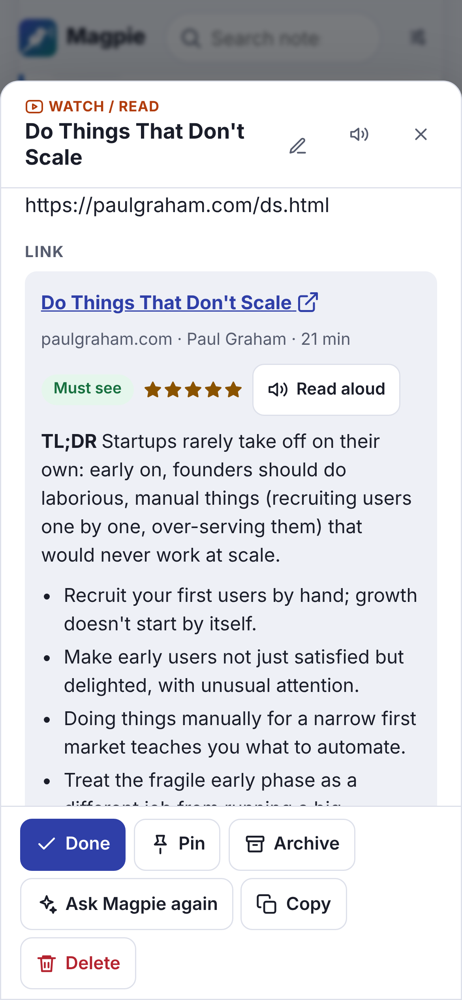

<p align="center">
  
</p>

<h1 align="center">Magpie</h1>

<p align="center">
  <strong>Say “notes on”, talk, and Magpie does the rest.</strong><br>
  A voice-first notebook that lives on your computer. The AI you choose files your notes,<br>
  reminds you when it matters, and writes short reviews of the videos and articles you save.
</p>

<p align="center">
  <a href="https://github.com/Coder-ux-coder/magpie/releases/latest/download/MagpieSetup.exe"><strong>Download Magpie for Windows</strong></a>
  · <a href="#quick-start">Mac and Linux</a>
</p>

<p align="center">
  <a href="https://github.com/Coder-ux-coder/magpie/actions/workflows/ci.yml"></a>
  <a href="https://github.com/Coder-ux-coder/magpie/actions/workflows/windows-app.yml"></a>
  <a href="LICENSE"></a>
  
</p>

<p align="center">
  
  
  <br><sub>Screenshots use the sample notes from <code>scripts/seed_demo.py</code>.</sub>
</p>

---

You think of things at the worst moments: in the middle of an email, a meeting, a game.
Magpie lets you say them out loud and forget about them. On Windows it's an app that starts
with your computer and is always listening for its command word, whatever you're doing:

> *“Notes on. Remind me to call James at five about the budget. Notes off.”*

A small bar appears at the bottom of the screen with your words as you speak. Magpie tidies
them up, gives the note a title, files it as a task in your **Work** category, and at
5:00 PM a reminder pops up in the corner of your screen (and an email arrives on your phone,
if you like): *“Call James about the budget · due today 5:00 PM”*. Say *“the electricity
bill is due on the 10th”* and it decides for itself to nudge you the evening before. Share
a YouTube video and you get a two-line verdict on whether it's worth your time.

## Features

**Always listening, in any program (the Windows app)**
- Magpie starts with Windows and waits by the clock. Say **“notes on”** anywhere, in any
  program, and a small bar floats up at the bottom of the screen with your words as you
  speak, without taking the keyboard from what you were doing. Say **“notes off”** (or just
  stop talking, or press **Save**) and it's saved; **“cancel note”** throws it away, with
  **Undo**. Click the bar to type into it.
- Listening happens **on your computer**, with an offline speech model: nothing you say
  leaves it, and only the note's text goes to your AI once it's saved.
- Reminders **pop up in the corner of the screen** with Done, Snooze and Open.
- No password, no Docker, nothing to configure, and it **updates itself**. The tray icon
  opens your notes, starts a note, and turns listening off and on.

<p align="center"></p>

**…and everywhere else**
- In the notes window (or any browser) the voice bar sits at the bottom of every view: say
  “notes on”, press the mic or type, watch the words appear, fix anything, save.
- Share links to Magpie on your phone, send **Telegram** text or voice messages, say
  **“Hey Siri, notes on”**, use a bookmarklet, the HTTP API, the command line
  (`magpie add "…"`) or the MCP server for Claude Desktop and Claude Code.

**Your categories, your colours**
- Make your own categories, such as Work, Home and Family, each in its own colour, in the
  order you like. They're tabs right next to the inbox.
- The AI files each note into the category that fits. A note you write while a category's
  tab is open stays there, and you can drag any note onto a tab (or onto Done or Archive).
- Every note remembers which tab you were on when you wrote it.
- **It learns your way:** when you move a note to another category or change its kind,
  Magpie remembers and files similar notes the same way. You can see and forget each lesson.

**Any AI, or none**
- **Claude Haiku 5.5** by default: fast and low-cost. Switch to Sonnet or Opus, or to
  **ChatGPT**, **Gemini**, **OpenRouter**, a free model on your own computer with
  **Ollama**, any OpenAI-compatible service, or **no AI at all** (simple rules file your
  notes).
- A welcome screen sets it all up the first time: your AI, reminders, your command word and
  your categories. Keys are checked before they're saved and stay on your computer.
- **Your instructions:** standing rules the AI follows, like “tag anything about the shop
  with #shop” or “remind me 30 minutes before meetings”. Titles are written for you, and
  you can change any of them.

**It decides when to remind you**

| You say | Magpie does |
| --- | --- |
| “remind me at 5 pm”, “every Monday at 9”, “in 20 minutes” | Schedules exactly that, on your computer's clock |
| “the bill is due on the 10th” | Suggests a reminder shortly before it matters, and says why |
| “idea: voice replies for reminders” | No ping; it shows up in tomorrow's digest |
| “had a great chat with Dad today” | Just files it |

Choose how proactive it is: *quiet*, *balanced* or *proactive*.

**Reminders where you'll see them**
- **Pop-ups** on your computer, with Done and Snooze buttons, and **email** for your phone
  (just your address and an app password). Telegram, ntfy and Slack or Discord webhooks
  work too.
- A **daily digest** each morning and a **weekly review** of themes and open loops.
- **Ask your notes** anything: *“what did I decide about rent?”*
- A **calendar feed** for Google, Apple or Outlook Calendar.

**Reviews of what you save**
- YouTube videos (from the transcript), articles and PDFs get a TL;DR, key points, a verdict
  (*must see*, *worth it*, *skim*, *skip*), a rating and who it's for.
- With Claude, mention something without a link (*“that Veritasium video on the Monty Hall
  problem”*) and it finds it with web search first.

**Made for everyone**
- Works with a keyboard alone (press <kbd>?</kbd>) and with screen readers.
- Read-aloud replies, adjustable text size, high contrast, reduced motion, dark mode.
- Notes taken offline are kept on the device and synced later.

**Yours**
- Your notes are one SQLite file on your computer. Export everything as JSON or Markdown
  at any time.
- **No password:** Magpie only answers on your own computer, so there's nothing to log in to.
- **Updates itself:** the app installs new versions when you're not taking a note (each
  download is checked against the release before it runs), and Docker installs pick up a
  new version within the hour, going back to the one that worked if it fails to start.

## Quick start

### Windows

1. **Download [MagpieSetup.exe](https://github.com/Coder-ux-coder/magpie/releases/latest/download/MagpieSetup.exe)**
   and double-click it. There's nothing to answer and no administrator password: Magpie
   installs for you, starts, and opens its welcome screen. (Windows may say *Windows
   protected your PC*, because Magpie isn't signed by a company: click *More info* →
   *Run anyway*.)
2. **The welcome screen** asks which AI to use, how to remind you, your command word and
   your categories.
3. **Say “notes on”**, in any program. That's it: Magpie starts with Windows from now on,
   waits by the clock, and keeps itself up to date.

**Used Magpie in Docker before?** Install the app the same way. On its first start it
brings over your notes and settings (but no password) and stops the Docker version, so
reminders don't arrive twice. Your Docker data stays where it was, untouched.

### Mac and Linux

Magpie runs in [Docker Desktop](https://www.docker.com/products/docker-desktop/) (free):
download [magpie-main.zip](https://github.com/Coder-ux-coder/magpie/archive/refs/heads/main.zip),
unzip it, and in Terminal `cd` into the folder and run `sh setup.sh`. Magpie starts, adds a
Magpie icon to your apps and opens in its own window; there's nothing to answer. Then say
“notes on” (Magpie listens while its window is open).

New to all this? The **[step-by-step guide](docs/getting-started.md)** walks through every
click and fixes common problems.

<details>
<summary>Other ways to install</summary>

**The app with Python** (Mac and Linux too, still new there; Python 3.11 or newer, and on
Linux GTK or Qt for its windows):

```bash
python3 -m pip install "magpie-notes[desktop] @ https://github.com/Coder-ux-coder/magpie/archive/refs/heads/main.zip"
python3 -m magpie desktop      # downloads the speech model (40 MB) the first time
```

**Docker on Windows**, as a server instead of the app: double-click `setup-docker.cmd` in
the unzipped folder.

**Docker without the script:** `docker compose up -d`, then open <http://localhost:8000>.
`.env.example` lists every setting.

**A server without Docker** (run it from the same folder every time):

```bash
python3 -m pip install https://github.com/Coder-ux-coder/magpie/archive/refs/heads/main.zip
python3 -m magpie setup     # writes .env
python3 -m magpie serve     # on Windows use py instead of python3
```

</details>

### No API key? Use Magpie inside Claude

[`artifact/magpie.html`](artifact/magpie.html) is a version of Magpie that runs as a Claude
artifact. Claude files your notes with your own Claude account (Haiku 5.5 by default), so
there's no API key and nothing to install. It keeps your notes private to you, with your
categories, reminders while it's open (plus Google Calendar and Outlook links), *My day*
and Ask. To make your own copy, ask Claude Code to “publish `artifact/magpie.html` as an
artifact with the db, user, sample and downloads capabilities”. Its notes export to a file
you can import into a self-hosted Magpie later (Settings → Data), categories included.

The self-hosted Magpie can't use a Claude subscription: apps outside Claude need an API
key. That's why it also works with other AIs, including free ones, or with none.

### Make it yours

Everything is in **Settings**, no restart needed:

- **AI:** the service, the model, and its key.
- **Reminders:** pop-ups on this device, email, Telegram, and a test for each.
- **Categories:** names, colours and order; what Magpie has learned from your changes.
- **Voice:** command and stop words, the silence timeout, and whether Magpie listens for
  the command word (in a browser: your accent too).
- **Your instructions**, **about you**, how **proactive** to be, your **morning**, the
  **snooze** length, the **digest** and **weekly review** times.
- **Time:** follow this computer's time zone (on by default), or pick one.
- **Display:** theme, text size, high contrast, reduced motion, read-aloud.

### Next steps

1. **Get reminders on your phone.** Easiest: **Settings → Reminders → Email** with your
   phone's email address. Or connect Telegram: create a bot with
   [@BotFather](https://t.me/BotFather), set `MAGPIE_TELEGRAM_BOT_TOKEN`, restart, then
   open **Settings → Reminders → Connect Telegram**; you can send it notes too.
2. **Hands-free on iPhone:** set up the [“Hey Siri, notes on” Shortcut](docs/integrations.md#iphone-and-ipad-hey-siri-notes-on),
   or send notes to your Telegram bot.
3. **Magpie on a server** that your phone can open too: see the
   [deployment guide](docs/deployment.md) (a server other devices reach needs HTTPS and a
   password).

The app keeps a log in `%LOCALAPPDATA%\Magpie\logs`. For Docker, run
`docker compose exec magpie magpie doctor` to check your setup.

## Documentation

| | |
| --- | --- |
| [Getting started](docs/getting-started.md) | Step by step for Windows, Mac and Linux, and fixes for common problems |
| [Integrations](docs/integrations.md) | Email, pop-ups, Telegram, Siri, Android, bookmarklet, calendar, Claude Desktop (MCP), the HTTP API |
| [Deployment](docs/deployment.md) | HTTPS, servers, Raspberry Pi, backups, updates, troubleshooting |
| [Configuration](docs/configuration.md) | Every setting, with defaults |
| [Architecture](docs/architecture.md) | How the pieces fit, the data model, how the AI is used |
| [Product spec](docs/SPEC.md) | The refined brief Magpie was built from |
| [AGENTS.md](AGENTS.md) | For AI coding agents (and humans) working on the code |

## How Magpie uses AI

Every note is one request to the AI you chose, asking for a fixed JSON shape: the cleaned
text, title, kind, category, tags, any reminders (as local wall-clock times, which Magpie
converts with your time zone) and a one-line reply. With Claude this uses
[structured outputs](https://platform.claude.com/docs/en/build-with-claude/structured-outputs),
so the answer is always valid; other services get a JSON schema, and Magpie checks and
repairs what comes back. Reviews, digests, web search and Ask are separate requests.

**What it costs** depends on the model and your habits. Haiku 5.5, the default, costs
the least of the three Claude models; Sonnet and Opus cost more per note but handle tricky dates and
long notes more carefully. Ollama on your own computer and *no AI* cost nothing. Check
actual spend with your provider; Settings → AI shows Magpie's token counts.

## Privacy

Magpie keeps your notes in a SQLite file on your computer. To do its job it sends:

- **note text and saved pages** to the AI you chose (nothing, with Ollama or no AI) for
  filing, reviews, digests and Ask;
- **no audio from the Windows app:** it listens with an offline speech model on your
  computer. In a browser, the mic uses the browser's speech service (Chrome and Edge use
  their makers' servers, Safari uses Apple's); Telegram voice notes and server-side
  transcription go to your speech-to-text provider;
- **messages** to whichever reminder channels you set up (email, Telegram, ntfy, …);
- a check for new versions: the app asks GitHub every few hours; Docker installs ask
  GitHub's container registry about once an hour (turn that off with
  `MAGPIE_AUTO_UPDATE=false`).

Nothing else leaves your computer. See [SECURITY.md](SECURITY.md) to report a vulnerability.

## Development

```bash
git clone https://github.com/Coder-ux-coder/magpie.git && cd magpie
python -m venv .venv && . .venv/bin/activate
pip install -e ".[dev,mcp]"
MAGPIE_BRAIN=fake magpie serve           # http://localhost:8000
pip install -e ".[desktop]" && MAGPIE_BRAIN=fake magpie desktop   # the app

pytest                                   # Python tests (offline, no API key needed)
node --test "tests/js/*.test.mjs"        # browser-side tests
ruff check src tests scripts && ruff format --check src tests scripts
```

The web app is plain JavaScript modules with no build step: edit a file and reload.
Read [CONTRIBUTING.md](CONTRIBUTING.md) and [AGENTS.md](AGENTS.md) before opening a pull request.

## Roadmap

- WhatsApp reminders (needs the WhatsApp Business API)
- Photo notes: whiteboards, posters and receipts, read by the AI
- Two-way calendar sync
- A signed Windows installer, and the app on Mac
- Shared lists for families and teams

Ideas and pull requests are welcome.

## License

[MIT](LICENSE). Magpie is an independent open-source project and is not affiliated with Anthropic.
