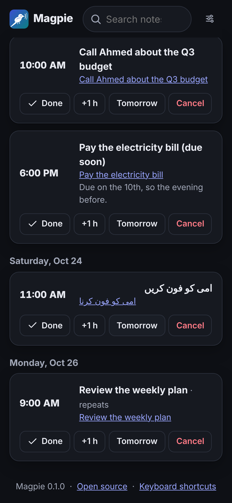

<p align="center">
  
</p>

<h1 align="center">Magpie</h1>

<p align="center">
  <strong>Say “notes on”, talk, and Claude does the rest.</strong><br>
  A self-hosted, voice-first notebook that files your notes, reminds you when it matters,<br>
  and writes short reviews of the videos and articles you save.
</p>

<p align="center">
  <a href="https://github.com/Coder-ux-coder/magpie/actions/workflows/ci.yml"></a>
  <a href="LICENSE"></a>
  
</p>

<p align="center">
  
  
  
  <br><sub>Screenshots use the sample notes from <code>scripts/seed_demo.py</code>.</sub>
</p>

---

You think of things at the worst moments: driving, walking, half asleep. Magpie lets you
say them out loud and forget about them:

> *“Notes on. Remind me to call Ahmed at five about the budget. Notes off.”*

Claude cleans up the transcript, files it as a task, and sends you a Telegram message at
5:00 PM with **Done** and **Snooze** buttons. Say *“electricity bill is due on the 10th”*
and it decides for itself to nudge you the evening before. Share a YouTube video and you
get a two-line verdict on whether it's worth your time.

## Features

**Capture any way you like**
- **Hands-free in the browser:** say “notes on”, talk, say “notes off” (or just pause).
  “Cancel note” throws it away. Wake and stop phrases work in any language you choose.
- **Tap or type:** a big mic button, a text box, or paste a link.
- **On your phone:** install Magpie as an app and share links to it, send **Telegram** text
  or voice messages, or say **“Hey Siri, notes on”** with an iOS Shortcut.
- **From anywhere else:** a bookmarklet for any web page, an HTTP API, a command line
  (`magpie add "…"`), and an MCP server so Claude Desktop and Claude Code can read and add notes.

**Claude files everything**
- Fixes transcription mistakes and drops the “uh”s, keeping your words and your language
  (English, Urdu, Hindi, Spanish, or any mix).
- Titles, tags and sorts each note: task, idea, link, journal, meeting, reference, list.
- **Decides when to ping you:**

  | You say | Claude does |
  | --- | --- |
  | “remind me at 5 pm”, “every Monday at 9”, “in 20 minutes” | Schedules exactly that, in your time zone |
  | “the bill is due on the 10th” | Suggests a reminder shortly before it matters, and says why |
  | “idea: voice replies for reminders” | No ping; it shows up in tomorrow's digest |
  | “had a great chat with Dad today” | Just files it |

  Choose how proactive it is: *quiet*, *balanced* or *proactive*.

**Reviews of what you save**
- YouTube videos (from the transcript), articles and PDFs get a TL;DR, key points, a verdict
  (*must see*, *worth it*, *skim*, *skip*), a rating and who it's for.
- Mention something without a link (*“that Veritasium video on the Monty Hall problem”*)
  and Claude finds it with web search first.

**Stay on top of it**
- Reminders via **Telegram**, **browser push**, **ntfy**, **email** or **Slack/Discord
  webhooks**, with one-tap Done and Snooze.
- A **daily digest** each morning and a **weekly review** of themes and open loops.
- **Ask your notes** anything: *“what did I decide about rent?”*
- A **calendar feed** for Google, Apple or Outlook Calendar, plus JSON and Markdown export.

**Made for everyone**
- Works with a keyboard alone (press <kbd>?</kbd>) and with screen readers.
- Read-aloud replies, adjustable text size, high contrast, reduced motion, dark mode.
- Right-to-left scripts such as Urdu and Arabic display correctly.
- Installs as an app; notes taken offline are kept on the device and synced later.

**Yours**
- Self-hosted: one small container and one SQLite file. No account with anyone but Anthropic.
- Password-protected, with a revocable API token, CSRF protection, signed one-tap links and
  protection against fetching private network addresses.

## Quick start

You need [Docker](https://docs.docker.com/get-docker/). A
[Claude API key](https://console.anthropic.com/settings/keys) makes Magpie smart; you can
add it during setup or later in the dashboard.

```bash
git clone https://github.com/Coder-ux-coder/magpie.git
cd magpie
./setup.sh
```

That's all. The script asks for your Claude API key, a password (or makes one) and your
time zone (it suggests your computer's), then starts Magpie at <http://localhost:8000>.
Run it again any time to change those answers; your notes are kept.

<details>
<summary>Other ways to install</summary>

**Docker without the script:** `docker compose up -d`, then open <http://localhost:8000>.
The generated password is in `docker compose logs magpie`, and you can paste your Claude
key in **Settings → Claude**. Or copy `.env.example` to `.env` and fill it in first.

**Without Docker** (Python 3.11 or newer):

```bash
pipx install "magpie-notes @ git+https://github.com/Coder-ux-coder/magpie"   # or pip install
magpie setup     # asks the same questions and writes .env
magpie serve
```

**No API key yet?** Set `MAGPIE_BRAIN=fake` to try everything with a simple offline
stand-in for Claude, and `python scripts/seed_demo.py` to load sample notes.

</details>

### Make it yours

Everything below is in **Settings**, no restart needed:

- **Your rules for Claude:** standing instructions such as “tag anything about the shop
  with #shop”, “remind me 30 minutes before meetings” or “keep titles in Urdu”.
- **About you**, how **proactive** Claude should be, your **morning**, the **snooze**
  length, the **digest** and **weekly review** times.
- **Voice:** wake and stop phrases in any language, the language you speak, silence timeout.
- **Notifications:** switch each channel on or off and send a test.
- **Display:** theme, text size, high contrast, reduced motion, read-aloud.

### Next steps

1. **Get reminders on your phone.** Telegram is the easiest: create a bot with
   [@BotFather](https://t.me/BotFather), set `MAGPIE_TELEGRAM_BOT_TOKEN`, restart, then
   open **Settings → Notifications → Connect Telegram**. You can then also send the bot
   notes, including voice messages if you set `MAGPIE_STT_API_KEY`.
2. **Use the microphone on your phone.** Browsers only allow the mic over HTTPS. Put Magpie
   behind HTTPS ([deployment guide](docs/deployment.md)), set `MAGPIE_BASE_URL`, and install
   it from the browser menu (“Add to Home Screen”).
3. **Hands-free on iPhone:** set up the [“Hey Siri, notes on” Shortcut](docs/integrations.md#iphone-and-ipad-hey-siri-notes-on).

Run `magpie doctor` (or `docker compose exec magpie magpie doctor`) to check your setup.

## Documentation

| | |
| --- | --- |
| [Integrations](docs/integrations.md) | Telegram, Siri, Android, bookmarklet, calendar, Claude Desktop (MCP), the HTTP API |
| [Deployment](docs/deployment.md) | HTTPS, servers, Raspberry Pi, backups, updates, troubleshooting |
| [Configuration](docs/configuration.md) | Every setting, with defaults |
| [Architecture](docs/architecture.md) | How the pieces fit, the data model, how Claude is used |
| [Product spec](docs/SPEC.md) | The refined brief Magpie was built from |
| [AGENTS.md](AGENTS.md) | For AI coding agents (and humans) working on the code |

## How Magpie uses Claude

Every note is one call to the Claude API with a
[structured output](https://platform.claude.com/docs/en/build-with-claude/structured-outputs)
schema, so the answer is always valid JSON: the cleaned text, title, kind, tags, any
reminders (as local wall-clock times, which Magpie converts with your time zone) and a
one-line reply. Reviews, digests, web search and Ask are separate calls. The default model
is `claude-opus-5-5`; set `MAGPIE_MODEL` to change it.

**What it costs** depends on your model and habits. As a rough guide with the default
model, filing a note costs around one to two US cents, and reviewing an article or a short
video a few cents (long transcripts cost more). `claude-sonnet-5-5` costs about half as
much, and `claude-haiku-5-5` a small fraction. Check actual spend in the
[Anthropic Console](https://console.anthropic.com/); the dashboard shows token counts under
**Settings → Claude**.

## Privacy

Magpie keeps your notes in a SQLite file on your server. To do its job it sends:

- **note text and saved pages** to the Claude API (Anthropic) for filing, reviews, digests and Ask;
- **audio** to your browser's speech service when you use the browser mic (Chrome uses
  Google's servers, Safari uses Apple's), or to your speech-to-text provider for Telegram
  voice notes and server-side transcription;
- **messages** to whichever notification channels you set up (Telegram, ntfy, email, …).

Nothing else leaves your server. See [SECURITY.md](SECURITY.md) to report a vulnerability.

## Development

```bash
git clone https://github.com/Coder-ux-coder/magpie.git && cd magpie
python -m venv .venv && . .venv/bin/activate
pip install -e ".[dev,mcp]"
MAGPIE_BRAIN=fake MAGPIE_PASSWORD=dev magpie serve      # http://localhost:8000

pytest                                   # Python tests (offline, no API key needed)
node --test "tests/js/*.test.mjs"        # browser-side tests
ruff check src tests scripts && ruff format --check src tests scripts
```

The web app is plain JavaScript modules with no build step: edit a file and reload.
Read [CONTRIBUTING.md](CONTRIBUTING.md) and [AGENTS.md](AGENTS.md) before opening a pull request.

## Roadmap

- WhatsApp reminders (needs the WhatsApp Business API)
- Photo notes: whiteboards, posters and receipts, read with Claude's vision
- Two-way calendar sync
- Speech recognition fully on the device
- Dashboard translations
- Shared lists for families and teams

Ideas and pull requests are welcome.

## License

[MIT](LICENSE). Magpie is an independent open-source project and is not affiliated with Anthropic.
