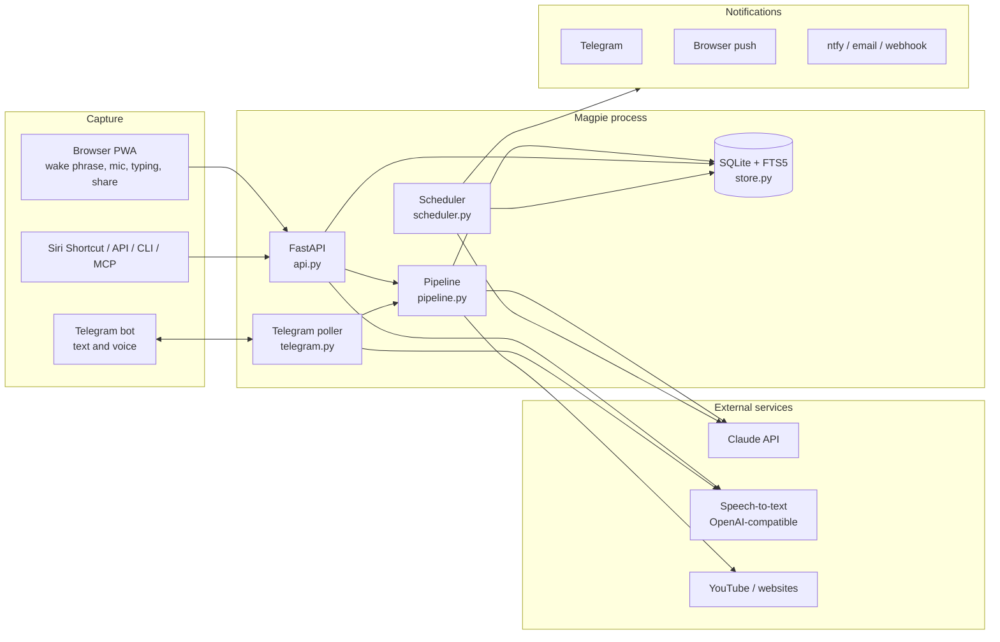
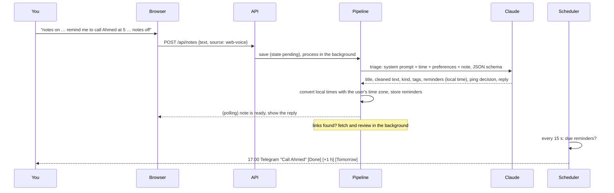
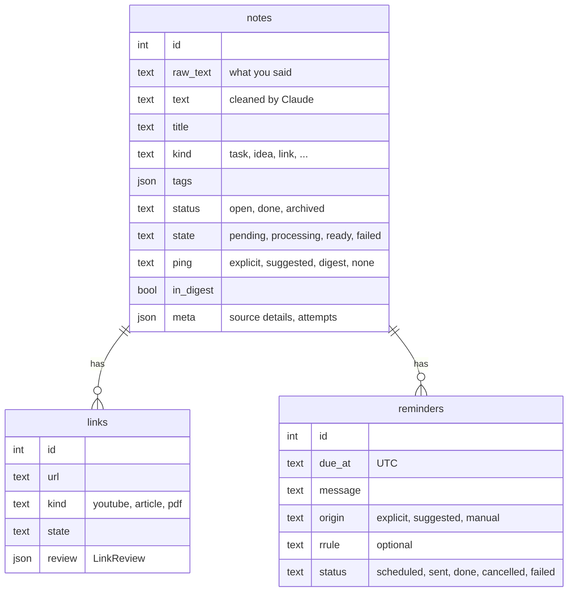

# Architecture

Magpie is a single Python process: a FastAPI web app plus a few background loops, with a
plain-JavaScript progressive web app as its front end and SQLite for storage.

## Life of a note

1. **Capture.** Every entry point ends in `Pipeline.submit()` or `Store.create_note()` plus
   `Pipeline.process()`. The note is stored immediately with `state = pending`, so nothing
   is lost if Claude is slow, down or not configured.
2. **Triage.** `ClaudeBrain.triage()` sends one request with a JSON schema generated from
   `schemas.Triage`. The current local time, the user's “about me”, morning time and
   proactivity go in the user message; the system prompt never changes, so it is
   prompt-cached.
3. **Reminders.** Claude returns wall-clock times (`2026-10-19T17:00`). `reminders.py`
   converts them with the user's IANA time zone (handling DST), validates any RRULE, drops
   or moves times in the past, and enforces the *quiet* setting.
4. **Links.** URLs from the text (and any Claude reconstructed from speech) become `links`
   rows. If the note names something without a URL, `find_link` uses Claude's web search.
   Each link is fetched (`content/fetch.py`: YouTube transcripts, readable article text,
   PDFs) and reviewed. If fetching fails, Claude reads the page itself with web fetch.
5. **Delivery.** The scheduler fires due reminders through every enabled channel and
   retries with back-off if they all fail. Repeating reminders move to their next
   occurrence. It also sends the daily digest and weekly review at the user's local times.

The scheduler and the Telegram bot run under a supervisor (`Magpie._supervise`) that
restarts them after any unexpected error, and each reminder, update and channel is handled
on its own, so one bad item can't stop the rest.

## Modules

| Module | Responsibility |
| --- | --- |
| `config.py` | `Settings` (environment) and `Prefs` (dashboard, stored in the database) |
| `db.py` | SQLite connection, numbered migrations, FTS5 index |
| `store.py` | Every SQL statement; returns Pydantic models from `models.py` |
| `schemas.py` | Structured outputs Claude returns (`Triage`, `LinkReview`, …) |
| `brain/` | `ClaudeBrain` (real), `FakeBrain` (offline), prompts and the shared interface |
| `pipeline.py` | Triage, link reviews, retries, events for listeners (the Telegram bot) |
| `reminders.py` | Turning plans into reminders; done, snooze, tomorrow, cancel |
| `scheduler.py` | The clock: due reminders, digests |
| `digest.py` | Gathering digest data, plain-text fallback, sending |
| `notify/` | Channels: Telegram, web push, ntfy, email, webhook |
| `telegram.py`, `telegram_api.py` | The bot (long polling, pairing, commands, buttons) and a small API client |
| `content/` | Finding URLs, blocking private addresses, fetching pages and transcripts |
| `stt.py` | OpenAI-compatible speech-to-text |
| `api.py`, `app.py` | HTTP API, auth, public endpoints (action links, calendar), static files |
| `auth.py` | Generated secrets, signed action links, login rate limiting |
| `export.py`, `ics.py` | JSON/Markdown export and import, iCalendar feed |
| `core.py` | Builds and wires every service; starts and stops background tasks |
| `cli.py`, `mcp_server.py` | Command line and the MCP server |
| `web/` | The PWA: `index.html`, `sw.js`, `static/js/*.js`, `static/css/app.css` |

## Data model

Plus `digests`, `push_subscriptions` and a `kv` table for preferences, generated secrets,
VAPID keys and the Telegram polling offset. All times are stored as UTC ISO strings.

## Claude usage

- Model `claude-opus-5-5` by default; every request sets `output_config.effort`
  explicitly (`low` for triage and digests, `medium` for reviews, Ask and weekly reviews).
- Structured outputs via `output_config.format` (JSON schema from the Pydantic models,
  transformed with `anthropic.transform_schema`). No forced `tool_choice`, no prefill, no
  thinking budget, since current models reject them.
- Server-side refusal fallbacks (`fallbacks: "default"`) on models that support them,
  dropped automatically if an account doesn't allow them.
- Web search (`web_search_20260209`) to find things mentioned without a link, web fetch
  (`web_fetch_20260209`) when a page can't be downloaded locally; paused server-tool turns
  are resumed.
- `stop_reason` is checked before reading content (`refusal`, `max_tokens`, `pause_turn`).
- Transient errors (rate limits, overload, network) leave the note pending and retry with
  back-off; permanent errors mark it failed with a readable message.

## Security model

- Single user per installation. The dashboard uses a password and a signed session
  cookie; state-changing requests also need an `X-Magpie` header (CSRF protection).
  Integrations use a bearer token.
- One-tap Done/Snooze links are signed, scoped to one action on one reminder, expire after
  14 days, and change nothing on `GET`.
- Links are only fetched from public addresses: every hop of a redirect is checked against
  private, loopback and link-local ranges.
- Strict Content-Security-Policy, no inline scripts, and DOM built without `innerHTML`.
- Fetched pages are treated as untrusted data in prompts and reviews have no tools that
  can change anything.
- The Docker image runs as an unprivileged user.
