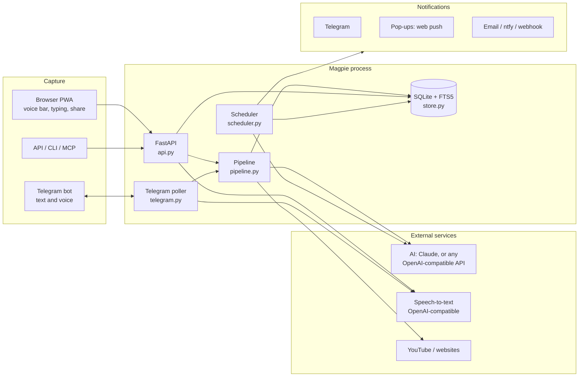
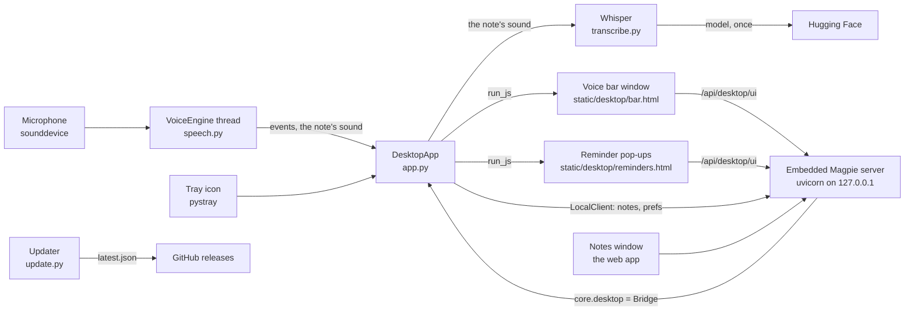
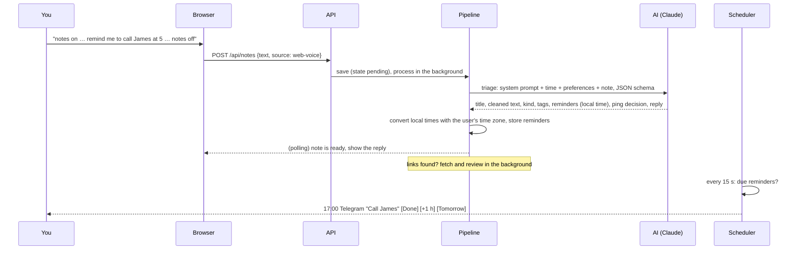
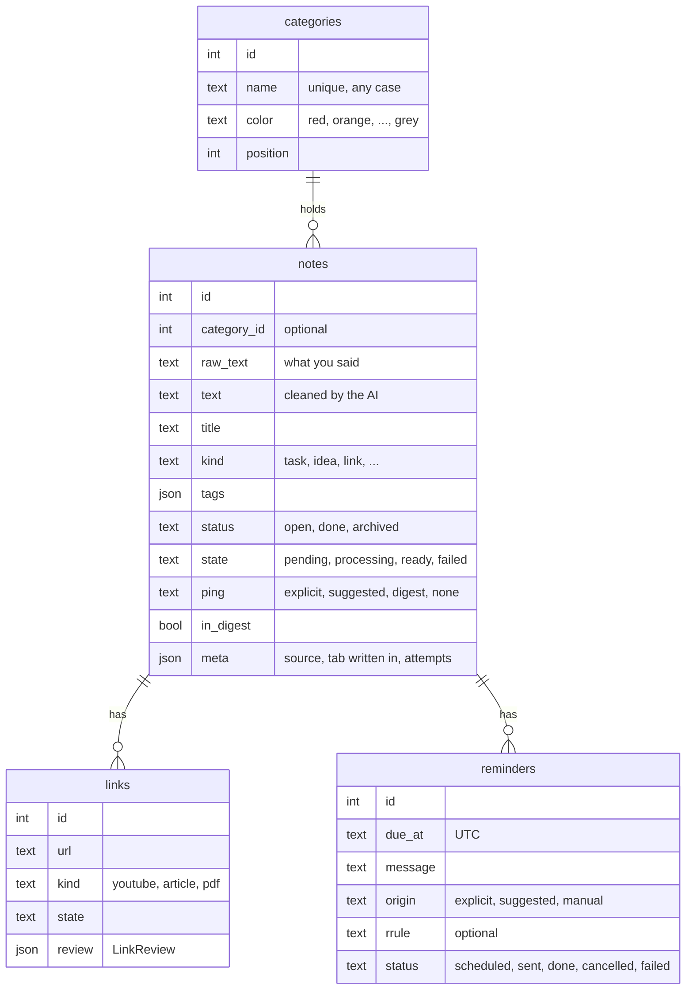

# Architecture

Magpie is a single Python process: a FastAPI web app plus a few background loops, with a
plain-JavaScript progressive web app as its front end and SQLite for storage. The app (for
Windows and Mac) is that process with more inside it: see [The desktop app](#the-desktop-app).

## The desktop app

`magpie.desktop` (Magpie.exe, Magpie.app, or `magpie desktop` from Python) runs everything above
in one process, plus what makes it an app:

- **Listening** (`speech.py`): the `VoiceEngine` thread reads the microphone in quarter-second
  chunks and feeds a `Listener`. In standby a Vosk recogniser restricted to the command word
  (plus "[unk]") runs all the time; it costs a few percent of one core. The command word
  only counts at the start of what's said (at most one word before it). When it's heard, a
  full recogniser starts from the exact sample where the command word ended (the last eight
  seconds are kept in a ring buffer, so “notes on buy milk” in one breath loses nothing),
  and a small grammar recogniser listens for the stop and cancel words, whose timings say
  where the note ends. A stop word must end what's said, and a stop word only heard in a
  partial result must stand for half a second. Silence (the dashboard's setting) or five
  minutes also end a note. Command words the model doesn't know are matched in the full
  text instead. The note's own sound is kept, from the end of the command word (or the
  last words typed over) to the start of the stop word, or half a second after the last
  word.
- **Writing it down** (`transcribe.py`): when a note ends, Whisper (faster-whisper,
  CTranslate2, int8 on the CPU) writes its sound down again, much more accurately, with
  punctuation; voice activity detection skips silences, where Whisper would otherwise make
  words up, and the command words it may still hear are trimmed. Whisper is loaded when a
  note starts and let go after five idle minutes. Its model isn't in the installer:
  `Whisper` downloads the chosen one (`small.en`, or `large-v3-turbo`) into the app's
  `models` folder once, retrying later if that fails, and the one before
  keeps working meanwhile. Whenever Whisper is missing, fails or runs past its time budget,
  the listener's words are saved instead.
- **Windows** (`ui.py`): pywebview (WebView2 on Windows, WebKit on a Mac) shows the notes
  window (the web app itself) and two floating windows served by the same server: the voice
  bar and the reminder pop-ups. They're shown, hidden and placed without being activated
  (the Windows API, or the NSWindow's `orderFrontRegardless`), so they don't take the
  keyboard; a click on the bar hands it over for typing. The pages reach the app through
  `/api/desktop/ui`, and the app drives them with `run_js`; pywebview's `js_api` isn't used
  because it needs `eval`, which the CSP refuses. On a Mac, AppKit is only touched from the
  main thread (`on_main`), where pywebview and the menu bar icon share the event loop, and
  Magpie is in the Dock only while its notes window is open.
- **The server** (`server.py`): `EmbeddedServer` runs uvicorn in a thread on 127.0.0.1 with
  no password. `core.desktop` is the app's `Bridge`: `/api/status` and `/api/desktop` report
  what the app is doing, `/api/desktop/command` lets the dashboard start a note or turn
  listening off, and the `desktop` notification channel hands reminders to the app's pop-ups.
  Prefs changes (the command word) reach the listener at once.
- **The system** (`system.py`): one copy at a time (a lock file; a second start asks the
  first to show itself), starting with the computer (the `Run` registry key on Windows, a
  LaunchAgent on a Mac), the window or app in front (kept with the note, like the tab a note
  was written in).
- **First start** (`migrate.py`): if this computer ran Magpie in Docker, its database is
  copied with SQLite's backup, its settings minus any password become `magpie.env`, and the
  old containers are stopped and kept from restarting.
- **Updates** (`update.py`): every six hours, or when the update button asks,
  `latest.json` from the latest release names the version and, for each system, the
  download's URL (only this repository's releases are accepted), size and SHA-256. A newer
  download is fetched, checked, and installed once no note is being taken (or at once, from
  *Update now*): on Windows the installer runs silently; on a Mac a small script waits for
  Magpie to quit, swaps in the new Magpie.app (putting the old one back if that fails) and
  opens it. `Bridge.status()["update"]` is what Settings → Updates shows.
- **Packaging** (`packaging/`): PyInstaller bundles Python, the web app, the listener's
  speech model and Whisper's libraries (`bundle.py`); on Windows, Inno Setup makes a
  per-user installer with no pages; on a Mac, the recipe makes Magpie.app (microphone
  permission text, menu bar app), zipped for the release, which `install.sh` puts in
  Applications. The [App workflow](../.github/workflows/app.yml) runs `--self-test` on the
  built and the installed app on a real Windows and Mac, and publishes one release.

## Life of a note

1. **Capture.** Every entry point ends in `Pipeline.submit()` or `Store.create_note()` plus
   `Pipeline.process()`. The note is stored immediately with `state = pending`, so nothing
   is lost if the AI is slow, down or not configured. A note written in a category's tab
   gets that category at once (`meta.category_by = "you"`), and `meta.captured_in` records
   the tab.
2. **Triage.** The brain's `triage()` (`ClaudeBrain`, `OpenAICompatibleBrain` or
   `BasicBrain`) sends one request with a JSON schema generated from `schemas.Triage`. The
   current local time, the user's “about me”, morning time, proactivity, instructions,
   categories, the tab the note was written in and the lessons learned from earlier
   corrections go in the user message; the system prompt never changes, so it is
   prompt-cached. The AI's category is used only when the user hasn't chosen one.
3. **Reminders.** The AI returns wall-clock times (`2026-10-19T17:00`). `reminders.py`
   converts them with the user's IANA time zone (handling DST), validates any RRULE, drops
   or moves times in the past, and enforces the *quiet* setting.
4. **Links.** URLs from the text (and any the AI reconstructed from speech) become `links`
   rows. If the note names something without a URL, `find_link` uses Claude's web search
   (other AIs skip this step). Each link is fetched (`content/fetch.py`: YouTube
   transcripts, readable article text, PDFs) and reviewed. If fetching fails, Claude reads
   the page itself with web fetch.
5. **Delivery.** The scheduler fires due reminders through every enabled channel and
   retries with back-off if they all fail. Repeating reminders move to their next
   occurrence. It also sends the daily digest and weekly review at the user's local times.

The scheduler and the Telegram bot run under a supervisor (`Magpie._supervise`) that
restarts them after any unexpected error, and each reminder, update and channel is handled
on its own, so one bad item can't stop the rest.

## Modules

| Module | Responsibility |
| --- | --- |
| `config.py` | `Settings` (environment) and `Prefs` (dashboard, stored in the database) |
| `db.py` | SQLite connection, numbered migrations, FTS5 index |
| `store.py` | Every SQL statement; returns Pydantic models from `models.py` |
| `schemas.py` | Structured outputs the AI returns (`Triage`, `LinkReview`, …) |
| `brain/` | `providers.py` (presets, and `resolve()` for the provider, model, address and key in force), `ClaudeBrain`, `OpenAICompatibleBrain`, `CodexBrain` (runs `codex exec`, signed in on the computer), `BasicBrain` (no AI) and `FakeBrain` (tests), prompts and the shared interface |
| `pipeline.py` | Triage, link reviews, retries, events for listeners (the Telegram bot) |
| `reminders.py` | Turning plans into reminders; done, snooze, tomorrow, cancel |
| `scheduler.py` | The clock: due reminders, digests |
| `digest.py` | Gathering digest data, plain-text fallback, sending |
| `notify/` | Channels: the desktop app's pop-ups, web push, email (dashboard or `MAGPIE_SMTP_*`), Telegram, ntfy, webhook |
| `telegram.py`, `telegram_api.py` | The bot (long polling, pairing, commands, buttons) and a small API client |
| `content/` | Finding URLs, blocking private addresses, fetching pages and transcripts |
| `stt.py` | OpenAI-compatible speech-to-text |
| `api.py`, `app.py` | HTTP API, auth, public endpoints (action links, calendar), static files |
| `auth.py` | Generated secrets, signed action links, login rate limiting |
| `export.py`, `ics.py` | JSON/Markdown export and import, iCalendar feed |
| `core.py` | Builds and wires every service; starts and stops background tasks |
| `cli.py`, `mcp_server.py` | Command line and the MCP server |
| `desktop/` | The app for Windows and Mac: listening, writing notes down (Whisper), windows, tray or menu bar, moving from Docker, updates ([above](#the-desktop-app)) |
| `web/` | The PWA: `index.html`, `sw.js`, `static/js/*.js` (the voice bar in `capture.js` and `voice.js`, setup controls in `controls.js`, the first-run screen in `welcome.js`), `static/css/app.css` |
| `artifact/magpie.html` | Magpie as a Claude artifact: notes in the artifact's per-user store, filed with the viewer's own Claude account |

## Data model

Plus `digests`, `push_subscriptions` and a `kv` table for preferences, generated secrets,
the AI choice and saved keys (`ai`), the email set-up (`email`), lessons learned from
corrections (`lessons`), VAPID keys and the Telegram polling offset. All times are stored as
UTC ISO strings.

## AI usage

Settings → AI picks the provider, unless `MAGPIE_BRAIN` fixes it on the server.
`providers.resolve()` decides what is in force (a saved key only counts for the address it
was entered for), and `Magpie.set_ai()` checks a new choice with a tiny request before
saving it, then swaps the brain without a restart.

Claude:

- Model `claude-haiku-5-5` by default; every request sets `output_config.effort`
  explicitly (`low` for triage and digests, `medium` for reviews, Ask and weekly reviews).
- Structured outputs via `output_config.format` (JSON schema from the Pydantic models,
  transformed with `anthropic.transform_schema`). No forced `tool_choice`, no prefill, no
  thinking budget, since current models reject them.
- Server-side refusal fallbacks (`fallbacks: "default"`) on models that support them,
  dropped automatically if an account doesn't allow them.
- Web search to find things mentioned without a link, web fetch when a page can't be
  downloaded locally (`web_search_20260209`/`web_fetch_20260209` on models with dynamic
  filtering, `web_search_20250305`/`web_fetch_20250910` on Haiku); paused server-tool
  turns are resumed.
- `stop_reason` is checked before reading content (`refusal`, `max_tokens`, `pause_turn`).
- Transient errors (rate limits, overload, network) leave the note pending and retry with
  back-off; permanent errors mark it failed with a readable message.

Other services (`OpenAICompatibleBrain`, `/chat/completions`):

- Structured output is tried as `json_schema` (strict for OpenAI), then `json_object`, then
  the schema described in the prompt; the mode that works is remembered. Replies are parsed
  leniently (`<think>` blocks and code fences removed) and one repair request fixes a reply
  that doesn't match the schema.
- Refusals, content filters and cut-off replies become readable errors; connection
  failures and 429/5xx answers are retried quickly, then left to the pipeline's back-off.
- No web search or page fetching: reviews use the text Magpie fetched itself.

## Security model

- Single user per installation, with no password: the app listens on 127.0.0.1 only, and
  the dashboard only answers requests for local host names (blocking DNS rebinding).
  (`magpie serve` on a server that other devices reach sets `MAGPIE_PASSWORD` and uses a
  signed session cookie.) State-changing requests always need an `X-Magpie` header (CSRF
  protection). Integrations use a bearer token.
- The app only installs updates from this repository's GitHub releases, and only a
  download whose size and SHA-256 match `latest.json`. Codex, when chosen, runs read-only
  in an empty folder with its shell tools off, the note on stdin.
- API keys and the email app password are stored on the server and never returned; the
  dashboard only learns whether one is saved.
- One-tap Done/Snooze links are signed, scoped to one action on one reminder, expire after
  14 days, and change nothing on `GET`.
- Links are only fetched from public addresses: every hop of a redirect is checked against
  private, loopback and link-local ranges.
- Strict Content-Security-Policy, no inline scripts, and DOM built without `innerHTML`.
- Fetched pages are treated as untrusted data in prompts and reviews have no tools that
  can change anything.
