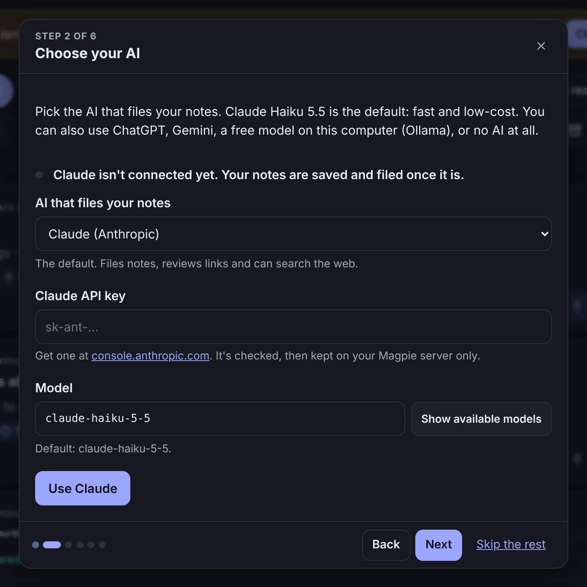

# Getting started

This guide is for anyone who has never run a program like Magpie before. It takes about
15 minutes, most of it waiting for downloads.

## What "running Magpie" means

Magpie is a small program that runs on **your own computer** (or a home server), not on a
website. Once it's set up you open it like any other program, from the Magpie icon, and it
opens in its own window. On your phone you use it through Telegram or the browser.

A phone or tablet can't run Magpie itself; it needs a Windows, Mac or Linux computer that is
switched on. Your notes stay on that computer.

You need:

- **Docker Desktop**, a free program that runs Magpie in its own little box, so you don't
  have to install anything else.
- Optionally an **AI**, which makes Magpie smart: it files your notes, decides when to
  remind you and reviews links. Magpie works with Claude (Haiku 5.5 is the default), ChatGPT,
  Google Gemini, OpenRouter, or a free AI on your own computer (Ollama), and without any AI
  too. You choose on Magpie's welcome screen the first time it opens.

## Windows

1. **Install Docker Desktop** from
   [docker.com/products/docker-desktop](https://www.docker.com/products/docker-desktop/).
   Run the installer with the default options. If it asks to install or update WSL, say yes
   and restart the computer when it asks.
2. **Start Docker Desktop** from the Start menu and wait until it shows *Engine running*
   (the first start can take a minute). You can skip signing in.
3. **Download Magpie:**
   [magpie-main.zip](https://github.com/Coder-ux-coder/magpie/archive/refs/heads/main.zip).
   Open your Downloads folder, right-click the file and choose **Extract All**, then
   **Extract**.
4. Open the extracted **magpie-main** folder and **double-click `setup.cmd`**. (If Windows
   says it protected your PC, click **More info**, then **Run anyway**.)
5. A black window opens. The first time, it spends a few minutes downloading Magpie. Then it
   asks two questions. Press Enter to accept the suggestion in [brackets]:
   - whether you want a **password**. Press Enter for none: then only this computer can
     open Magpie. Set one if you also want to open Magpie on your phone over Wi-Fi, and
     **write it down**;
   - your **time zone**, such as `Europe/London`: press Enter to use the one shown.
6. It asks whether to **open Magpie when you sign in to Windows** (press Y or N), puts a
   **Magpie icon** on your Desktop and in the Start menu, and opens Magpie in its own window.
7. **The welcome screen** walks you through the rest: which AI files your notes (paste its
   key there; it's checked first), pop-ups and email for reminders, your command word, and
   your own categories. Each step can be skipped and changed later in Settings. Then say
   “notes on” and your first note. From now on, open Magpie from its icon.

<p align="center"></p>

## Mac

1. **Install Docker Desktop** from
   [docker.com/products/docker-desktop](https://www.docker.com/products/docker-desktop/)
   (pick *Apple Silicon* or *Intel* to match your Mac: Apple menu → About This Mac). Open the
   downloaded file and drag Docker to Applications.
2. **Start Docker** from Applications and wait until the whale icon in the menu bar says
   *Docker Desktop is running*.
3. **Download Magpie:**
   [magpie-main.zip](https://github.com/Coder-ux-coder/magpie/archive/refs/heads/main.zip).
   Double-click it in Downloads to unzip it.
4. Open **Terminal** (press Cmd+Space, type *Terminal*, press Enter) and paste these two
   lines, pressing Enter after each:

   ```bash
   cd ~/Downloads/magpie-main
   sh setup.sh
   ```

5. Answer the two questions (a password if you want one, your time zone; see step 5 for
   Windows). Magpie is added to your **Applications** folder and Launchpad, asks whether to
   open when you log in, and opens in its own window with the welcome screen (step 7 for
   Windows). From now on, open Magpie from Applications or Launchpad.

## Linux

Install [Docker Engine](https://docs.docker.com/engine/install/) and the Compose plugin,
then:

```bash
git clone https://github.com/Coder-ux-coder/magpie.git
cd magpie
sh setup.sh
```

On a desktop, the setup adds Magpie to your applications menu and asks whether to open it
when you log in.

## Every day

- **The voice bar** sits at the bottom of Magpie. Say **“notes on”**, talk, and watch your
  words appear; fix anything by typing; then say **“notes off”** or press **Save**. Press
  **Cancel** (or Esc) to throw a note away, and **Undo** if you didn't mean to. You can
  also just type and press Enter (Shift+Enter starts a new line). Alt+N starts or stops the
  mic from anywhere.
- Magpie **starts listening** for “notes on” when it opens, once you've allowed the
  microphone (the bar asks once). The options button on the bar changes the command and stop
  words, turns listening off, or lets you check each voice note before it's saved. While it
  listens, Chrome and Edge send the audio to their speech service.
- **Pop out** (the arrow on the bar, in Chrome and Edge) keeps the bar in a small window on
  top of your other programs.
- **Categories** are tabs next to the inbox. Write a note while a category's tab is open and
  it stays there; drag a note onto a tab to move it.
- **Open Magpie from its icon**: the Desktop or Start menu on Windows, Applications or
  Launchpad on a Mac, the applications menu on Linux. It opens in its own window, and starts
  Docker Desktop and Magpie first if they aren't running. (Any browser works too, at
  <http://localhost:8000>.)
- **Magpie keeps running** in the background and starts again by itself whenever Docker
  starts, so reminders arrive even when its window is closed.
- **Updates are automatic.** Magpie checks for a new version every hour and restarts on it
  within a few seconds. Your notes and settings are kept, and if a new version doesn't start
  properly, Magpie goes back to the one that worked. To turn this off or pick a version, see
  [Updates](deployment.md#updates).
- **To stop it**, open Docker Desktop → *Containers* and press stop next to *magpie*, or run
  `docker compose stop` in the Magpie folder. Opening Magpie from its icon starts it again.
- **To change your password or time zone**, run the setup again. Everything else, the AI
  included, is in Settings. Your notes are kept.
- **To remove the icons**:
  - Windows: delete *Magpie* from the Desktop, and in the Start menu right-click *Magpie* →
    *More* → *Open file location* and delete it there. To stop it opening when you sign in,
    press Windows+R, type `shell:startup`, press Enter and delete *Magpie*.
  - Mac: drag *Magpie* from Applications to the Bin, and remove it in System Settings →
    General → Login Items.
  - Linux: delete `~/.local/share/applications/magpie.desktop` and
    `~/.config/autostart/magpie.desktop`.

  Running the setup again puts them back.

## Installed Magpie before automatic updates?

Copies of Magpie set up before October 2026 don't update themselves yet. Update once by
hand, and Magpie takes care of it from then on:

1. Download [magpie-main.zip](https://github.com/Coder-ux-coder/magpie/archive/refs/heads/main.zip)
   again.
2. Extract it the same way as the first time (Windows: right-click → **Extract All** →
   **Extract**). When Windows asks, choose **Replace the files in the destination**. Your
   answers are kept in the `.env` file, which isn't in the ZIP, so it stays as it is. (On a
   Mac, unzip it and copy the new files over the old folder.)
3. Run the setup again (`setup.cmd`, or `sh setup.sh`). At the password question, press
   Enter to keep your password, or type `none` to stop using one (then only this computer
   can open Magpie). Your notes, your AI key and your settings are kept.

If you extracted it somewhere new instead, copy the `.env` file from the old folder into the
new one before running the setup.

## On your phone

- The easiest way to get reminders on your phone is **email**: in Magpie open
  **Settings → Reminders → Email**, enter your address and an app password (the form links
  to where Gmail, Outlook, Yahoo and iCloud make one), and Magpie sends a test.
- **Telegram** also lets you send notes by text or voice, and gets reminders with Done and
  Snooze buttons. See [Telegram](integrations.md#telegram).
- On the same Wi-Fi, a phone can open Magpie only if Magpie has a password: run the setup
  again and choose one. (By default there's no password, and only this computer can open
  Magpie.) Then open `http://<your computer's address>:8000` in the phone's browser to read
  and type notes. The microphone in a browser needs a secure (`https://`) address, which
  [deployment](deployment.md#https) explains, for example with Tailscale.

## If something doesn't work

| What you see | What to do |
| --- | --- |
| You pasted `./setup.sh` into Windows PowerShell and nothing happened | That line is for Mac and Linux. On Windows, double-click `setup.cmd` instead. |
| *docker is not recognized* or *command not found: docker* | Docker Desktop isn't installed, or the window was opened before installing it. Install it, then open a new window. |
| *Docker Desktop is installed but not running*, or *Cannot connect to the Docker daemon* | Start Docker Desktop and wait for *Engine running*, then try again. |
| Windows: Docker Desktop asks for WSL, or says virtualization is off | Follow its instructions to install WSL and restart. If it says virtualization is disabled, it must be switched on in the computer's BIOS settings (search the web for your computer model and "enable virtualization"). |
| *Bind for 127.0.0.1:8000 failed: port is already allocated* (or *0.0.0.0:8000*) | Another program uses port 8000. Open the `.env` file in the Magpie folder with Notepad or TextEdit, add the line `MAGPIE_HOST_PORT=8080`, save, and run the setup again. The Magpie icon then opens the new address by itself. |
| *no configuration file provided* on Windows | The ZIP wasn't extracted. Right-click it → Extract All, and double-click `setup.cmd` in the extracted folder. |
| Mac: *permission denied: ./setup.sh* | Use `sh setup.sh` as shown above. |
| Magpie's window says it can't reach the site | Give Magpie a few more seconds to start and reload (Ctrl+R, or Cmd+R on a Mac). Still nothing? In the Magpie folder run `docker compose logs magpie` to see what it says. |
| The Magpie icon says *Docker Desktop is not running* | Start Docker Desktop, then open Magpie again. To have it ready every time, turn on *Start Docker Desktop when you sign in* in Docker Desktop's settings. |
| Windows asks whether to run *magpie.cmd* each time | Run `setup.cmd` again; it tells Windows the file is safe. |
| Magpie didn't update | In the Magpie folder run `docker compose logs updates`: it says what happened. If you set Magpie up before automatic updates existed, see [above](#installed-magpie-before-automatic-updates). |
| You forgot the password | Run the setup again and choose a new one, or none. |
| Notes are saved but not filed | Choose your AI, or add its key, in Settings → AI. |
| Magpie doesn't hear “notes on” | Press **Allow microphone** on the voice bar (or the mic button) and allow it. Check that listening is on in the bar's options. Firefox can't listen for a command word: use Chrome or Edge, or press the mic. |
| Email reminders don't arrive | Settings → Reminders → Email → *Send a test*. The message says what went wrong; usually the app password. Check your spam folder once. |
| No pop-ups appear | Settings → Reminders → *Turn on pop-ups here*, and allow notifications when the browser asks. On Windows and Mac, also check that the browser may show notifications (Focus or Do Not Disturb can hide them). |

Still stuck? Run `docker compose exec magpie magpie doctor` in the Magpie folder: it checks the
setup and says what's missing.

## Without Docker

If you already use Python 3.11 or newer, you can run Magpie directly. Make a folder for it
first and always start Magpie from that folder, because your notes are stored there.

```bash
# Windows (PowerShell)
mkdir magpie; cd magpie
py -m pip install https://github.com/Coder-ux-coder/magpie/archive/refs/heads/main.zip
py -m magpie setup
py -m magpie serve

# Mac or Linux
mkdir magpie && cd magpie
python3 -m pip install https://github.com/Coder-ux-coder/magpie/archive/refs/heads/main.zip
python3 -m magpie setup
python3 -m magpie serve
```

Leave that window open while you use Magpie, and open <http://localhost:8000>. Installed
this way, Magpie has no icon and doesn't update itself: to update, run the same
`pip install` line with `--upgrade` added.
